# Chronological Evaluation of Seven Machine-Learning Models for Next-Day Rainfall Classification in Australia

| **Krish Patel** | **Dharak Patel** | **Het Viradiya** |
|:---:|:---:|:---:|
| *Department of Computer Science (AI & ML)* *Unitedworld Institute of Technology* *Karnavati University* *Gandhinagar, Gujarat, India* krishpatel0875@gmail.com | *Department of Computer Science (AI & ML)* *Unitedworld Institute of Technology* *Karnavati University* *Gandhinagar, Gujarat, India* dp040607@gmail.com | *Department of Computer Science (AI & ML)* *Unitedworld Institute of Technology* *Karnavati University* *Gandhinagar, Gujarat, India* het.viradiya1924@gmail.com |

***Abstract—*Predicting whether it will rain tomorrow helps in planning and communicating risks but weather records can be unbalanced partially missing and ordered in time random splits can make results look better than they are. This paper compares seven classifiers (K-Nearest Neighbors, CatBoost, Random Forest, Decision Tree Linear SVM, Logistic Regression and Histogram Gradient Boosting) for the next-day RainTomorrow label using 142,193 cleaned daily observations and a protocol that avoids data leakage: a raw file that is not changed preprocessing that is done only on training data five expanding date-grouped chronological validation folds and a later-period holdout of 32,891 rows (21.92**

***Index Terms—*rainfall prediction, binary classification, temporal validation, class imbalance, CatBoost, ablation study.**

## I. INTRODUCTION

### A. Background

Knowing whether it will rain tomorrow matters for agriculture, transport, events and everyday planning. Operational forecasting relies mainly on weather prediction, which integrates physical models of the atmosphere with observations on large computers \[1\]. Machine-learning classifiers offer a data-driven alternative when station observations and a next-day label are available: given today’s temperature, pressure, humidity, wind, cloud, sunshine and rainfall, they estimate whether rain will occur on the following day. This study uses a course-supplied table of observations from 49 Australian locations (weatherAUS.csv) and treats the task as binary classification of the RainTomorrow label. The Australian Bureau of Meteorology publishes weather observations of this kind \[2\], but the exact provenance of the supplied snapshot was not independently verified.

### B. Literature Gap

Three practical issues make a fair comparison harder than calling a classifier on the table. First, rainy days are the minority class (22.42%), so accuracy alone can reward a model that rarely predicts rain \[3\]. Second, several predictors are missing for large fractions of rows (for example, Sunshine in 47.7%), so imputation fitted on the whole table can leak information. Third, the rows are ordered in time, and random cross-validation can mix future and past observations, which can give unreliable estimates when data are not stationary \[4\]. Comparisons of classifiers are difficult to interpret when these choices differ between models or when only accuracy is reported \[5\]. We do not claim to have surveyed every study of this dataset; the gap addressed here is methodological: a single, transparent, leakage-controlled protocol applied identically to several model families, followed by an ablation of the chosen pipeline.

### C. Proposed Solution

We propose a leakage-aware benchmarking pipeline rather than a new learning algorithm. The raw file is preserved and cleaned by a separate script; every fitted preprocessing step lives inside a model pipeline trained only on past data; hyperparameters are tuned with five expanding, date-grouped folds; and the final comparison uses the later 20% of calendar dates, untouched until the end. Seven standard families receive five predeclared configurations each, and AP is the selection metric because it focuses on the rainy minority class \[5\]. The selected model, CatBoost \[6\], is then analysed with a confusion matrix, an ROC curve and an ablation study.

### D. Contributions

1\. A reproducible cleaning–EDA–modelling pipeline in which the raw data are never modified and every fitted step is confined to training data.

2\. A seven-model benchmark with 35 predeclared configurations (175 fold evaluations) under date-grouped expanding-window validation, selecting by AP without using the holdout.

3\. Holdout evidence that CatBoost ranks rainy days best (AP 0.7068, ROC-AUC 0.8735; about 3.2 times the no-skill AP of 0.2192), while the leaders on accuracy and F1 (Random Forest), precision (K-Nearest Neighbors) and recall (Decision Tree) differ.

4\. An ablation of the selected pipeline showing that 3 pm humidity is by far the most influential input (AP −0.054 when removed) and that class weighting changes the operating point more than the ranking quality.

II\. RELATED WORK

### A. Physical and Statistical Forecasting

Numerical weather prediction has improved steadily by combining physical models with assimilated observations \[1\]. Such systems require substantial computing infrastructure, which motivates lightweight data-driven models trained on station records. This paper works in that second setting and makes no claim to compete with operational forecasts.

### B. Classical Learners

K-Nearest Neighbors (KNN) classifies by similarity to stored examples \[7\]. Support vector machines maximise a class margin \[8\]; we use a linear kernel solved with LIBLINEAR \[9\]. Logistic regression gives probabilistic outputs with a linear boundary. Decision trees partition the feature space recursively \[10\], and Random Forests average many randomised trees \[11\]. These families are standard baselines because they are fast, are available in scikit-learn \[12\], and make different assumptions about the data.

### C. Gradient Boosting and Tabular Data

Gradient boosting adds weak learners sequentially to reduce a loss \[13\]. Histogram-based implementations bin features for speed, as popularised by LightGBM \[14\], and scikit-learn’s HistGradientBoostingClassifier follows this idea. CatBoost \[6\] addresses prediction shift in boosting and handles categorical features with ordered statistics; in our pipeline the categorical features are one-hot encoded, so that capability is not exercised. Grinsztajn *et al.* \[15\] report that tree-based models remain strong on medium-sized tabular data compared with deep learning, which motivates our focus on tree ensembles and linear models rather than neural networks.

### D. Evaluation under Imbalance and Time Order

Learning from imbalanced data requires metrics beyond accuracy \[3\]. ROC analysis \[16\] summarises ranking quality across thresholds, whereas the precision–recall view is argued to be more informative when positives are rare \[5\]. Time-ordered data need validation that respects chronology \[4\]. Our work combines these ideas in one protocol: AP for selection, ROC-AUC and threshold metrics for reporting, and chronological folds for tuning. What is missing in a plain “fit and report accuracy” comparison, and why this protocol is justified, is a tuning and testing procedure in which no model can benefit from information it would not have had at forecast time.

III\. PROPOSED METHOD

### A. System Overview

Fig. 1 shows the data flow from the raw file to the final evaluation. Cleaning and exploratory analysis are separate scripts; modelling reads only the cleaned derivative and keeps whole calendar dates on one side of every split.

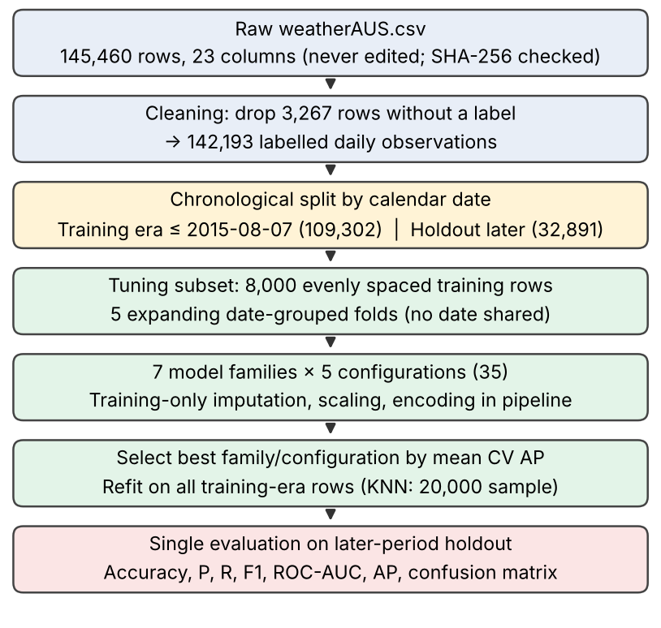

Fig. 1. End-to-end pipeline from the raw CSV to the single holdout evaluation.

### B. Mathematical Formulation

Let each observation *i* have a feature vector *xi* (16 numeric and 5 categorical predictors), a calendar date *ti* and a label *yi* ∈ {0, 1}, where 1 means rain on the next day. Given a cutoff date *τ* = 2015-08-07, the training and holdout index sets are

*D*train = {*i* : *ti* ≤ *τ*}, *D*test = {*i* : *ti* \> *τ*} (1)

A model outputs a score *F*(*x*) that is converted to a probability, and is trained with a class-weighted log-loss. With *N* training rows and *Nc* rows of class *c*, the balanced weights are

*wc* = *N* / (2*Nc*) (2)

*pi* = *σ*(*F*(*xi*)) = 1 / (1 + *e*−*F*(*x**i*)) (3)

*L*(*F*) = (1/*N*) Σ*i* *w*(*yi*) *ℓ*(*yi*, *pi*) (4)

*ℓ*(*y*, *p*) = −\[*y* log *p* + (1 − *y*) log(1 − *p*)\] (5)

Gradient boosting builds *F* additively. At iteration *m* a new tree *hm* is fitted to the gradient of *L* and added with learning rate *η*:

*Fm*(*x*) = *Fm*−1(*x*) + *η hm*(*x*) (6)

CatBoost uses symmetric decision trees of depth *d* with L2 leaf regularisation *λ* \[6\]. For model selection, the distinct dates of the tuning subset are divided into six blocks *B*0, …, *B*5. Fold *k* (*k* = 1, …, 5) trains on *B*0 ∪ … ∪ *Bk*−1 and validates on *Bk*, so validation is always later than training and no date is shared. A configuration *θ* is chosen by

*θ*\* = arg max*θ* (1/5) Σ*k*=15 AP*k*(*θ*) (7)

### C. Algorithmic Details

<table>
<colgroup>
<col style="width: 100%" />
</colgroup>
<tbody>
<tr class="odd">
<td>
<strong>Algorithm 1 Chronological benchmark</strong>

Input: cleaned data D; families M (7); 5 configs each

1: sort D by date; set cutoff τ at 80% of distinct dates

2: D_train ← rows with date ≤ τ; D_test ← later rows

3: S ← 8,000 evenly spaced rows of D_train (date order)

4: split distinct dates of S into blocks B0 … B5

5: for each family m in M and each config θ of m do

6: for k = 1 … 5 do

7: fit pipeline(m, θ) on B0 … B(k−1)

8: AP_k ← average precision on B_k

9: CV(m, θ) ← mean of AP_1 … AP_5

10: for each family m do

11: θ*_m ← argmax over θ of CV(m, θ)

12: refit pipeline(m, θ*_m) on D_train (KNN: 20,000 rows)

13: score D_test once: accuracy, P, R, F1, ROC-AUC, AP

14: return family with highest CV(m, θ*_m); never use D_test
</td>
</tr>
</tbody>
</table>

### D. Implementation Details

The pipeline is implemented in Python 3.12.3 with pandas 3.1.0, scikit-learn 1.9.1 \[12\] and the CatBoost library, with random seed 42 throughout. The selected CatBoost configuration is depth 5, 220 iterations, learning rate 0.07 and L2 leaf regularisation 7, with Logloss as the training loss, balanced class weights and a thread count of 4. Hyperparameters are tuned by GridSearchCV with the custom date-grouped folds and AP as the scoring function. The optimiser is gradient boosting itself (Eq. 6); no separate neural-network optimiser is involved. The software and compute settings used for every run are recorded in run_metadata.json, and the code is described in Appendix C.

IV\. EXPERIMENTAL SETUP

### A. Datasets

The course archive holds 145,460 records and 23 columns from 49 locations between 2007-11-01 and 2017-06-25. The response is RainTomorrow (Yes is the positive class). There are 16 numeric predictors and five categorical predictors (Location, WindGustDir, WindDir9am, WindDir3pm, RainToday); Date is used only for ordering and splitting. A separate script removes the 3,267 rows with no usable label (there are no invalid dates and no exact duplicates), trims text and sorts by date and location, leaving 142,193 rows (110,316 No, 31,877 Yes, 22.42% rainy). SHA-256 digests taken before and after cleaning are identical, confirming that the raw file was not modified. Missing predictor values and statistical outliers are kept.

The cleaned data are split by calendar date (Table I). All rows from a date lie on one side of the boundary, so a given day is never split across training and testing. The holdout is not used for any tuning or selection decision.

TABLE I

CHRONOLOGICAL SPLIT OF THE CLEANED DATA

| **Split** | **Period**               | **Rows** | **Dates** | **Rainy** |
|-----------|--------------------------|----------|-----------|-----------|
| Training  | 2007-11-01 to 2015-08-07 | 109,302  | 2,748     | 22.57%    |
| Holdout   | 2015-08-08 to 2017-06-25 | 32,891   | 688       | 21.92%    |
| Total     | 2007-11-01 to 2017-06-25 | 142,193  | 3,436     | 22.42%    |

Exploratory analysis was run on the cleaned file only. Fig. 2 shows the imbalance, and Fig. 3 shows that Sunshine (47.7%), Evaporation (42.8%), Cloud3pm (40.2%) and Cloud9am (37.7%) have the most missing values. The numeric predictors contain strongly redundant pairs (Fig. 4): MaxTemp–Temp3pm (*r* = 0.985), Pressure9am–Pressure3pm (*r* = 0.961) and MinTemp–Temp9am (*r* = 0.902). The pooled rainy rate varies by calendar month from 19.3% in January to 26.9% in July (Fig. 5), and the next-day rainy rate is 15.2% after RainToday = No but 46.4% after RainToday = Yes. These are descriptive associations, not causal estimates. Rainfall is strongly right-skewed and 17.9% of its non-missing values lie outside the Tukey 1.5×IQR fences; they are retained as potentially genuine extremes (Appendix B).

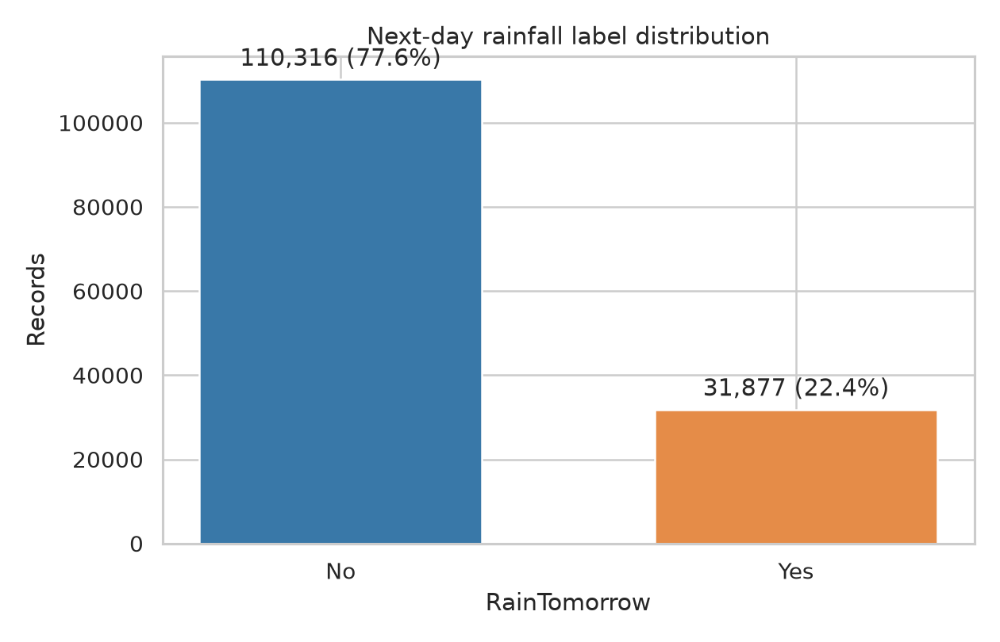

Fig. 2. Label counts after cleaning; 22.42% of records are rainy.

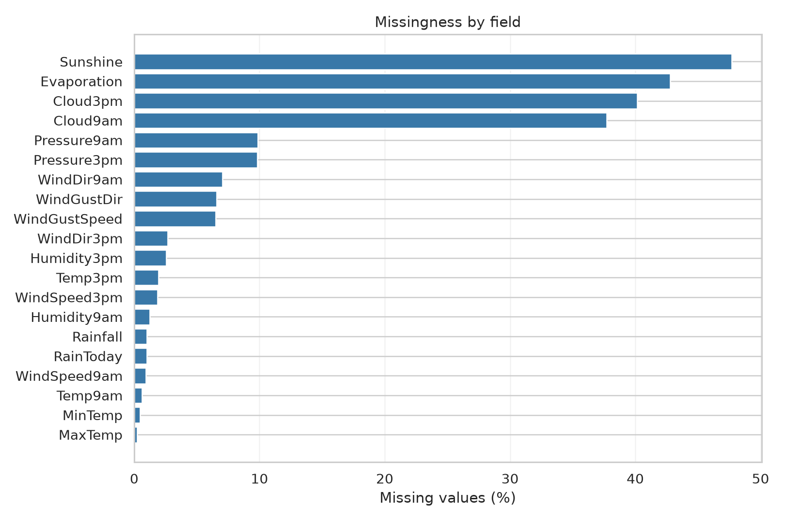

Fig. 3. Percentage of missing values by field.

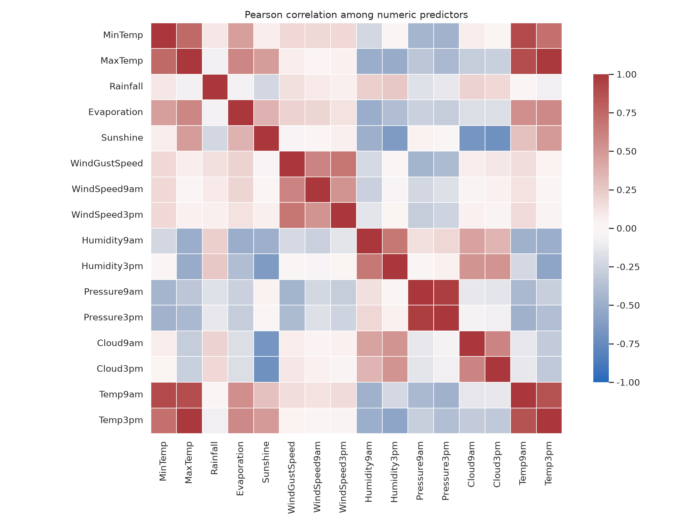

Fig. 4. Pearson correlations among numeric predictors.

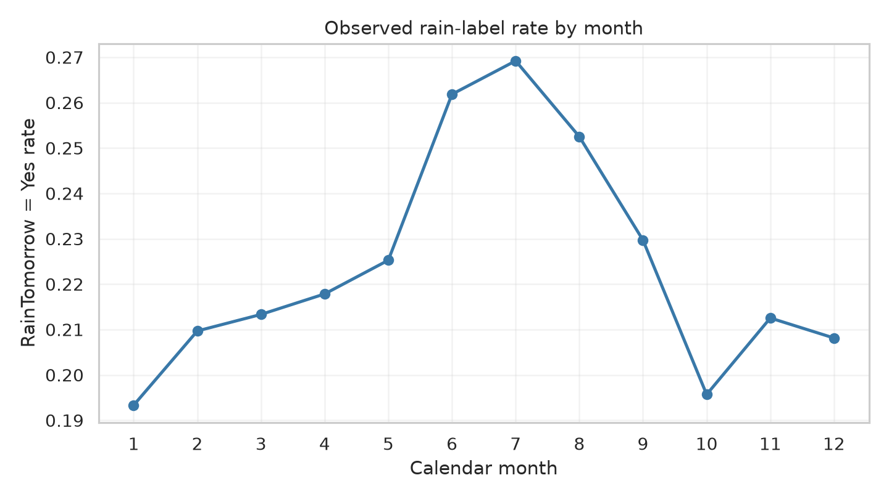

Fig. 5. Pooled next-day rainy rate by calendar month.

Preprocessing is fitted inside each pipeline on training data only. Numeric predictors receive median imputation with missingness-indicator columns (created for features that had missing values when the pipeline was fitted). Categorical predictors receive most-frequent imputation and one-hot encoding that ignores unseen categories. KNN, Linear SVM and Logistic Regression use standardised numeric features; tree-based models do not. Class imbalance is handled by balanced class weights in every family except KNN, which has no weighting option here.

### B. Baseline Models and Tuning Protocol

The comparison covers seven families: KNN, CatBoost, Random Forest, Decision Tree, Linear SVM, Logistic Regression and Histogram Gradient Boosting. Logistic Regression serves as the simple linear baseline, and the other five families serve as alternative baselines for CatBoost. As a no-skill reference, a classifier that always predicts No reaches 0.7808 accuracy on the holdout and has AP equal to the holdout prevalence, 0.2192. Each family has five predeclared configurations that vary neighbour count and weighting (KNN); iterations, depth, learning rate and L2 strength (CatBoost); tree count, depth, feature sampling and leaf size (Random Forest); criterion, depth, pruning and leaf size (Decision Tree); regularisation strength (Linear SVM); strength and penalty (Logistic Regression); and learning rate, iterations, leaf count and L2 strength (Histogram Gradient Boosting). Tuning uses a deterministic, evenly spaced 8,000-row subset of the training era to bound compute, giving 35 configurations and 175 fold evaluations. The chosen configuration of each family is then refit on all 109,302 training rows, except KNN, which uses a 20,000-row date-spanning sample because exact neighbour prediction becomes costly.

### C. Evaluation Metrics

Threshold-based metrics use the default decision rule (probability ≥ 0.5, or zero margin for the Linear SVM); no threshold is tuned on the holdout. With TP, FP and FN denoting true positives, false positives and false negatives for the rainy class,

Precision = TP / (TP + FP), Recall = TP / (TP + FN) (8)

F1 = 2 · Precision · Recall / (Precision + Recall) (9)

Accuracy is the share of correct labels. ROC-AUC measures ranking over all thresholds, and AP summarises the precision–recall curve:

AP = Σ*n* (*Rn* − *Rn*−1) *Pn* (10)

where *Pn* and *Rn* are precision and recall at the *n*-th threshold. AP is read against the holdout prevalence of 21.92%, which is the score of a no-skill ranker. For the Linear SVM, decision scores are used for ROC-AUC and AP.

## V. RESULTS

### A. Quantitative Results

Table II reports threshold-based holdout metrics and Table III reports ranking metrics. The best value in each column is in bold; the no-skill row is shown for reference and is excluded from that comparison. The families are listed in order of training-era CV AP, which is the only criterion used for selection.

TABLE II

THRESHOLD-BASED HOLDOUT METRICS

| **Model**                   | **Accuracy** | **Precision** | **Recall** | **F1**     |
|-----------------------------|--------------|---------------|------------|------------|
| CatBoost                    | 0.8041       | 0.5376        | 0.7622     | 0.6305     |
| Histogram Gradient Boosting | 0.7944       | 0.5213        | 0.7608     | 0.6187     |
| Logistic Regression         | 0.7900       | 0.5143        | 0.7622     | 0.6141     |
| Random Forest               | **0.8417**   | 0.6440        | 0.6218     | **0.6327** |
| Linear SVM                  | 0.7904       | 0.5148        | 0.7627     | 0.6147     |
| K-Nearest Neighbors         | 0.8290       | **0.7586**    | 0.3224     | 0.4525     |
| Decision Tree               | 0.7635       | 0.4756        | **0.7679** | 0.5874     |
| Always “No” (reference)     | 0.7808       | —             | 0.0000     | 0.0000     |

TABLE III

RANKING METRICS: TRAINING-ERA CV AP AND HOLDOUT SCORES

| **Model**                   | **CV AP**  | **ROC-AUC** | **Holdout AP** |
|-----------------------------|------------|-------------|----------------|
| CatBoost                    | **0.6837** | **0.8735**  | **0.7068**     |
| Histogram Gradient Boosting | 0.6769     | 0.8645      | 0.6908         |
| Logistic Regression         | 0.6759     | 0.8646      | 0.6842         |
| Random Forest               | 0.6700     | 0.8723      | 0.7043         |
| Linear SVM                  | 0.6676     | 0.8643      | 0.6842         |
| K-Nearest Neighbors         | 0.6395     | 0.8404      | 0.6363         |
| Decision Tree               | 0.5942     | 0.8429      | 0.6379         |
| No-skill reference          | —          | 0.5000      | 0.2192         |

TABLE IV

SELECTED CONFIGURATION OF EACH FAMILY

| **Model**                   | **CV AP** | **Best parameters**                                                        |
|-----------------------------|-----------|----------------------------------------------------------------------------|
| CatBoost                    | 0.6837    | depth=5; iterations=220; l2_leaf_reg=7; learning_rate=0.07                 |
| Histogram Gradient Boosting | 0.6769    | l2_regularization=1.0; learning_rate=0.05; max_iter=100; max_leaf_nodes=15 |
| Logistic Regression         | 0.6759    | C=0.3; penalty=l1                                                          |
| Random Forest               | 0.6700    | max_depth=None; max_features=0.7; min_samples_leaf=6; n_estimators=250     |
| Linear SVM                  | 0.6676    | C=0.03                                                                     |
| K-Nearest Neighbors         | 0.6395    | n_neighbors=81; weights=distance                                           |
| Decision Tree               | 0.5942    | ccp_alpha=0.0001; criterion=gini; max_depth=12; min_samples_leaf=50        |

CatBoost ranks first by CV AP (0.6837, ahead of Histogram Gradient Boosting at 0.6769) and also has the highest holdout AP (0.7068) and ROC-AUC (0.8735). Random Forest is very close on the holdout ranking metrics (AP 0.7043, ROC-AUC 0.8723); the 0.0025 AP gap is a single-run difference that we cannot separate from noise. Relative to the Logistic Regression baseline (AP 0.6842), CatBoost adds 0.0226 AP.

The threshold-based leaders differ. Random Forest has the highest accuracy (0.8417) and F1 (0.6327), K-Nearest Neighbors the highest precision (0.7586), and Decision Tree the highest recall (0.7679). KNN’s precision comes with the lowest recall (0.3224): it raises roughly 3,000 rain alerts on 32,891 days (about 9%), whereas CatBoost raises 10,224 (31.1%). Accuracy is also uninformative on its own, since always predicting “No” scores 0.7808. There is therefore no metric-independent winner, and the choice depends on the relative cost of missed rain and false alarms, which this study does not specify.

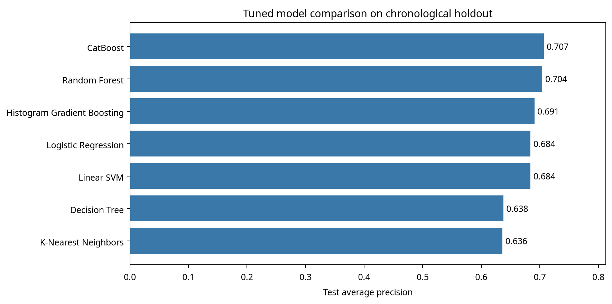

Fig. 6. Holdout average precision of the seven tuned models.

### B. Qualitative Results

Fig. 7 shows the confusion matrix and ROC curve of the selected CatBoost model on the holdout, and Table V gives its per-class report. Of 7,211 rainy days, 5,496 are detected (recall 0.7622) and 1,715 are missed; of 25,680 dry days, 4,728 are flagged as rainy. That is about 2.8 false alarms per missed rain day. When CatBoost predicts rain it is right 53.8% of the time, which is about 2.5 times the 21.92% base rate, and when it predicts no rain it is right 92.4% of the time. The ROC curve (AUC 0.8735) summarises all thresholds, while the matrix shows one operating point only.

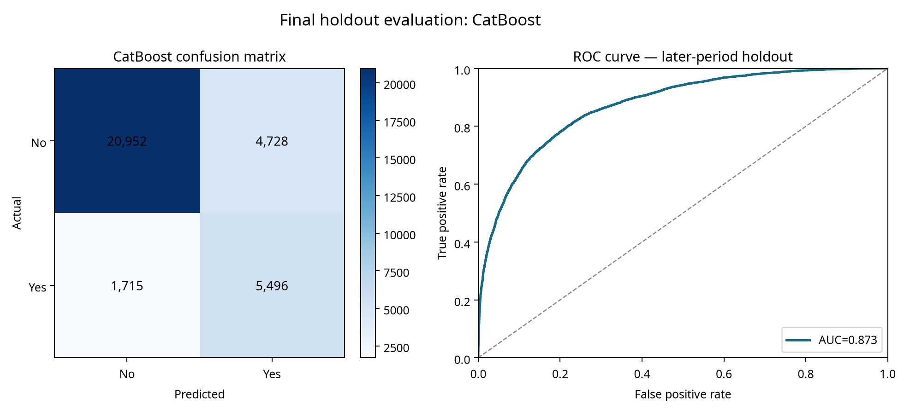

Fig. 7. CatBoost holdout confusion matrix (default threshold) and ROC curve.

TABLE V

CLASSIFICATION REPORT FOR CATBOOST ON THE HOLDOUT

| **Class**        | **Precision** | **Recall** | **F1** | **Support** |
|------------------|---------------|------------|--------|-------------|
| No               | 0.9243        | 0.8159     | 0.8667 | 25,680      |
| Yes              | 0.5376        | 0.7622     | 0.6305 | 7,211       |
| Macro average    | 0.7309        | 0.7890     | 0.7486 | 32,891      |
| Weighted average | 0.8395        | 0.8041     | 0.8149 | 32,891      |

### C. Ablation Study

To show which design choices matter, the selected CatBoost configuration (fixed hyperparameters) was refit on all training rows with one component removed at a time and scored once on the same holdout (Table VI, Fig. 8). The reference variant reproduces the main results to four decimals.

TABLE VI

ABLATION OF THE SELECTED CATBOOST PIPELINE (HOLDOUT)

| **Variant**                     | **Prec.** | **Recall** | **F1** | **AP** | **ΔAP** |
|---------------------------------|-----------|------------|--------|--------|---------|
| Full pipeline (reference)       | 0.5376    | 0.7622     | 0.6305 | 0.7068 | —       |
| w/o class weighting             | 0.7552    | 0.4847     | 0.5904 | 0.7087 | +0.0019 |
| w/o missingness indicators      | 0.5431    | 0.7586     | 0.6330 | 0.7037 | −0.0031 |
| w/o RainToday                   | 0.5413    | 0.7608     | 0.6326 | 0.7075 | +0.0008 |
| w/o Location                    | 0.5365    | 0.7602     | 0.6291 | 0.7002 | −0.0065 |
| w/o wind-direction features     | 0.5349    | 0.7613     | 0.6284 | 0.7064 | −0.0003 |
| w/o high-missingness numerics\* | 0.5386    | 0.7529     | 0.6280 | 0.7008 | −0.0060 |
| w/o 3 pm humidity               | 0.4912    | 0.7590     | 0.5964 | 0.6528 | −0.0540 |

\*Sunshine, Evaporation, Cloud9am and Cloud3pm removed. ΔAP is relative to the full pipeline.

Removing 3 pm humidity causes by far the largest change (AP 0.6528, −0.0540; ROC-AUC 0.8527). Removing class weighting leaves AP essentially unchanged (+0.0019) but moves the operating point sharply: precision rises to 0.7552, recall falls to 0.4847, accuracy rises to 0.8526 and F1 falls to 0.5904. Removing Location (−0.0065), the four high-missingness numeric fields (−0.0060) or the missingness indicators (−0.0031) lowers AP slightly, whereas removing RainToday (+0.0008) or the wind-direction fields (−0.0003) makes almost no difference. Because these runs use one seed and one holdout, differences below about 0.01 AP should not be treated as reliable.

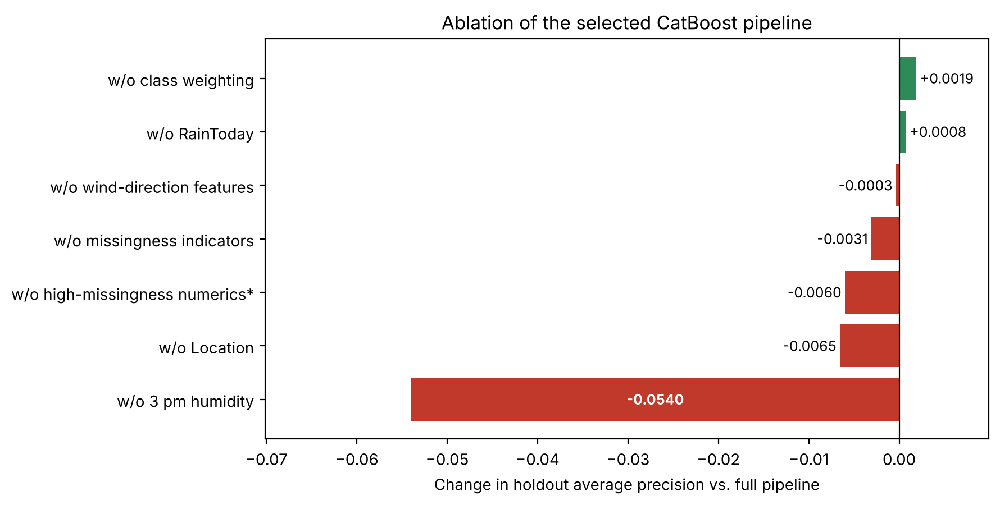

Fig. 8. Change in holdout AP when one component is removed.

VI\. DISCUSSION

### A. Interpretation

CatBoost’s edge in ranking is plausibly due to boosted trees capturing non-linear interactions among humidity, pressure, cloud and location, but the margin over Logistic Regression is small (0.0226 AP), which suggests that much of the signal is close to linear in these features. Afternoon humidity is a direct indicator of atmospheric moisture, so its large ablation effect is physically plausible; we did not run permutation importance or SHAP, and correlated fields such as Humidity9am and the cloud measurements remain available when it is removed, so the ablation shows the loss from removing one field rather than its full importance. The class-weight result shows that weighting mainly selects an operating point: the unweighted model ranks about as well, but alerts less often and with higher precision. Random Forest’s higher accuracy and precision relative to CatBoost reflect fewer positive alerts rather than better ranking.

### B. Comparison with Prior Work

We did not reproduce earlier studies on this dataset, and protocols differ, so we make no numerical comparison with published scores. Qualitatively, our findings agree with three points from the literature. Tree-based ensembles are strong on tabular data \[15\]: boosted trees and Random Forest lead the ranking metrics. Accuracy can mislead under imbalance \[3\], \[5\]: the always-“No” reference reaches 0.7808 accuracy, close to several tuned models. Evaluation that respects time order is advisable \[4\], and our holdout lies entirely after the training era. Our results differ from a strict “boosting always wins” reading in that Logistic Regression and the Linear SVM remain within about 0.02–0.03 AP of CatBoost.

### C. Limitations

Results come from one chronological holdout and one random seed, with no confidence intervals, so small gaps (CatBoost versus Random Forest; most ablation changes) are not established. The split tests future dates but not new locations, so geographic generalisation is untested. Tuning used an 8,000-row subset and five configurations per family, so each selected configuration is best only among those tested, and KNN’s final refit used a 20,000-row sample, which limits its comparability. The 0.5 decision rule is not optimised for any cost function and probability calibration was not evaluated. Features were removed one at a time, so correlated features may compensate. Finally, the exact upstream release and redistribution terms of the dataset snapshot were not independently verified.

### D. Future Work

Natural extensions are rolling-origin evaluation, location-held-out splits, larger hyperparameter searches under a stated compute budget, multiple seeds with bootstrap confidence intervals, probability calibration with a threshold chosen from explicit miss and false-alarm costs, feature-attribution analysis, and features that use several preceding days or neighbouring stations.

VII\. CONCLUSION

This paper addressed next-day rain classification under imbalance, missing data and time order. A reproducible pipeline kept the raw file intact, confined all fitted steps to past data, and compared seven model families with date-grouped chronological validation and a later-period holdout. CatBoost was selected by training-only CV AP and achieved 0.7068 AP and 0.8735 ROC-AUC on the holdout, with 0.7622 recall at 0.5376 precision. Random Forest, K-Nearest Neighbors and Decision Tree led on accuracy and F1, precision, and recall respectively, so model choice depends on error costs. The ablation identified 3 pm humidity as the dominant input and showed that class weighting shifts the operating point rather than the ranking. The findings are specific to this dataset snapshot and one temporal holdout and should be validated across locations and periods before any operational use.

## ACKNOWLEDGMENT

The authors thank the course instructors for the dataset and project brief.

## REFERENCES

\[1\] P. Bauer, A. Thorpe, and G. Brunet, “The quiet revolution of numerical weather prediction,” *Nature*, vol. 525, pp. 47–55, 2015, doi: 10.1038/nature14956.

\[2\] Australian Bureau of Meteorology, “Daily Weather Observations.” \[Online\]. Available: https://www.bom.gov.au/climate/dwo/

\[3\] H. He and E. A. Garcia, “Learning from imbalanced data,” *IEEE Trans. Knowl. Data Eng.*, vol. 21, no. 9, pp. 1263–1284, 2009, doi: 10.1109/TKDE.2008.239.

\[4\] C. Bergmeir and J. M. Benítez, “On the use of cross-validation for time series predictor evaluation,” *Inf. Sci.*, vol. 191, pp. 192–213, 2012, doi: 10.1016/j.ins.2011.12.028.

\[5\] T. Saito and M. Rehmsmeier, “The precision-recall plot is more informative than the ROC plot when evaluating binary classifiers on imbalanced datasets,” *PLOS ONE*, vol. 10, no. 3, p. e0118432, 2015, doi: 10.1371/journal.pone.0118432.

\[6\] L. Prokhorenkova, G. Gusev, A. Vorobev, A. V. Dorogush, and A. Gulin, “CatBoost: Unbiased boosting with categorical features,” in *Adv. Neural Inf. Process. Syst. 31*, 2018.

\[7\] T. Cover and P. Hart, “Nearest neighbor pattern classification,” *IEEE Trans. Inf. Theory*, vol. 13, no. 1, pp. 21–27, 1967, doi: 10.1109/TIT.1967.1053964.

\[8\] C. Cortes and V. Vapnik, “Support-vector networks,” *Mach. Learn.*, vol. 20, no. 3, pp. 273–297, 1995, doi: 10.1007/BF00994018.

\[9\] R.-E. Fan, K.-W. Chang, C.-J. Hsieh, X.-R. Wang, and C.-J. Lin, “LIBLINEAR: A library for large linear classification,” *J. Mach. Learn. Res.*, vol. 9, pp. 1871–1874, 2008.

\[10\] L. Breiman, J. H. Friedman, R. A. Olshen, and C. J. Stone, *Classification and Regression Trees*. Belmont, CA, USA: Wadsworth, 1984.

\[11\] L. Breiman, “Random forests,” *Mach. Learn.*, vol. 45, pp. 5–32, 2001, doi: 10.1023/A:1010933404324.

\[12\] F. Pedregosa *et al.*, “Scikit-learn: Machine learning in Python,” *J. Mach. Learn. Res.*, vol. 12, pp. 2825–2830, 2011.

\[13\] J. H. Friedman, “Greedy function approximation: A gradient boosting machine,” *Ann. Statist.*, vol. 29, no. 5, pp. 1189–1232, 2001, doi: 10.1214/aos/1013203451.

\[14\] G. Ke *et al.*, “LightGBM: A highly efficient gradient boosting decision tree,” in *Adv. Neural Inf. Process. Syst. 30*, 2017.

\[15\] L. Grinsztajn, E. Oyallon, and G. Varoquaux, “Why do tree-based models still outperform deep learning on typical tabular data?,” in *Adv. Neural Inf. Process. Syst. 35 (Datasets and Benchmarks Track)*, 2022.

\[16\] T. Fawcett, “An introduction to ROC analysis,” *Pattern Recognit. Lett.*, vol. 27, no. 8, pp. 861–874, 2006, doi: 10.1016/j.patrec.2005.10.010.

## APPENDIX A. ALL HYPERPARAMETER CONFIGURATIONS AND CV RESULTS

Every tested configuration is listed with its mean and standard deviation of AP over the five date-grouped chronological validation folds (8,000-row tuning subset). Parameter names omit the pipeline prefix model\_\_. Fold standard deviations describe variation across folds and are not confidence intervals.

TABLE VII

ALL 35 TESTED CONFIGURATIONS (RANK 1 IS THE SELECTED CONFIGURATION OF THE FAMILY)

| **Model**                   | **Rank** | **Parameters**                                                             | **Mean CV AP** | **Fold SD** |
|-----------------------------|----------|----------------------------------------------------------------------------|----------------|-------------|
| CatBoost                    | 1        | depth=5; iterations=220; l2_leaf_reg=7; learning_rate=0.07                 | 0.6837         | 0.0208      |
| CatBoost                    | 2        | depth=6; iterations=150; l2_leaf_reg=8; learning_rate=0.08                 | 0.6834         | 0.0193      |
| CatBoost                    | 3        | depth=6; iterations=160; l2_leaf_reg=5; learning_rate=0.05                 | 0.6817         | 0.0179      |
| CatBoost                    | 4        | depth=7; iterations=180; l2_leaf_reg=5; learning_rate=0.04                 | 0.6816         | 0.0205      |
| CatBoost                    | 5        | depth=5; iterations=120; l2_leaf_reg=3; learning_rate=0.05                 | 0.6761         | 0.0204      |
| Decision Tree               | 1        | ccp_alpha=0.0001; criterion=gini; max_depth=12; min_samples_leaf=50        | 0.5942         | 0.0211      |
| Decision Tree               | 2        | ccp_alpha=0.0005; criterion=log_loss; max_depth=16; min_samples_leaf=40    | 0.5856         | 0.0268      |
| Decision Tree               | 3        | ccp_alpha=0.0; criterion=entropy; max_depth=8; min_samples_leaf=30         | 0.5829         | 0.0279      |
| Decision Tree               | 4        | ccp_alpha=0.0003; criterion=entropy; max_depth=None; min_samples_leaf=60   | 0.5817         | 0.0278      |
| Decision Tree               | 5        | ccp_alpha=0.0; criterion=gini; max_depth=5; min_samples_leaf=20            | 0.5803         | 0.0291      |
| Histogram Gradient Boosting | 1        | l2_regularization=1.0; learning_rate=0.05; max_iter=100; max_leaf_nodes=15 | 0.6769         | 0.0215      |
| Histogram Gradient Boosting | 2        | l2_regularization=3.0; learning_rate=0.05; max_iter=180; max_leaf_nodes=31 | 0.6740         | 0.0212      |
| Histogram Gradient Boosting | 3        | l2_regularization=5.0; learning_rate=0.07; max_iter=200; max_leaf_nodes=15 | 0.6733         | 0.0177      |
| Histogram Gradient Boosting | 4        | l2_regularization=2.0; learning_rate=0.1; max_iter=120; max_leaf_nodes=23  | 0.6730         | 0.0199      |
| Histogram Gradient Boosting | 5        | l2_regularization=1.0; learning_rate=0.08; max_iter=150; max_leaf_nodes=31 | 0.6663         | 0.0208      |
| K-Nearest Neighbors         | 1        | n_neighbors=81; weights=distance                                           | 0.6395         | 0.0292      |
| K-Nearest Neighbors         | 2        | n_neighbors=61; weights=distance                                           | 0.6376         | 0.0299      |
| K-Nearest Neighbors         | 3        | n_neighbors=41; weights=distance                                           | 0.6366         | 0.0292      |
| K-Nearest Neighbors         | 4        | n_neighbors=21; weights=uniform                                            | 0.6089         | 0.0293      |
| K-Nearest Neighbors         | 5        | n_neighbors=11; weights=uniform                                            | 0.5797         | 0.0359      |
| Linear SVM                  | 1        | C=0.03                                                                     | 0.6676         | 0.0263      |
| Linear SVM                  | 2        | C=0.1                                                                      | 0.6605         | 0.0291      |
| Linear SVM                  | 3        | C=0.3                                                                      | 0.6553         | 0.0326      |
| Linear SVM                  | 4        | C=1.0                                                                      | 0.6516         | 0.0349      |
| Linear SVM                  | 5        | C=3.0                                                                      | 0.6499         | 0.0363      |
| Logistic Regression         | 1        | C=0.3; penalty=l1                                                          | 0.6759         | 0.0234      |
| Logistic Regression         | 2        | C=0.03; penalty=l1                                                         | 0.6755         | 0.0266      |
| Logistic Regression         | 3        | C=0.1; penalty=l2                                                          | 0.6742         | 0.0246      |
| Logistic Regression         | 4        | C=1.0; penalty=l2                                                          | 0.6614         | 0.0275      |
| Logistic Regression         | 5        | C=3.0; penalty=l2                                                          | 0.6559         | 0.0298      |
| Random Forest               | 1        | max_depth=None; max_features=0.7; min_samples_leaf=6; n_estimators=250     | 0.6700         | 0.0248      |
| Random Forest               | 2        | max_depth=None; max_features=sqrt; min_samples_leaf=4; n_estimators=220    | 0.6686         | 0.0247      |
| Random Forest               | 3        | max_depth=None; max_features=sqrt; min_samples_leaf=2; n_estimators=150    | 0.6676         | 0.0257      |
| Random Forest               | 4        | max_depth=18; max_features=0.7; min_samples_leaf=2; n_estimators=180       | 0.6657         | 0.0332      |
| Random Forest               | 5        | max_depth=24; max_features=log2; min_samples_leaf=5; n_estimators=220      | 0.6654         | 0.0285      |

## APPENDIX B. ADDITIONAL EXPLORATORY FIGURES

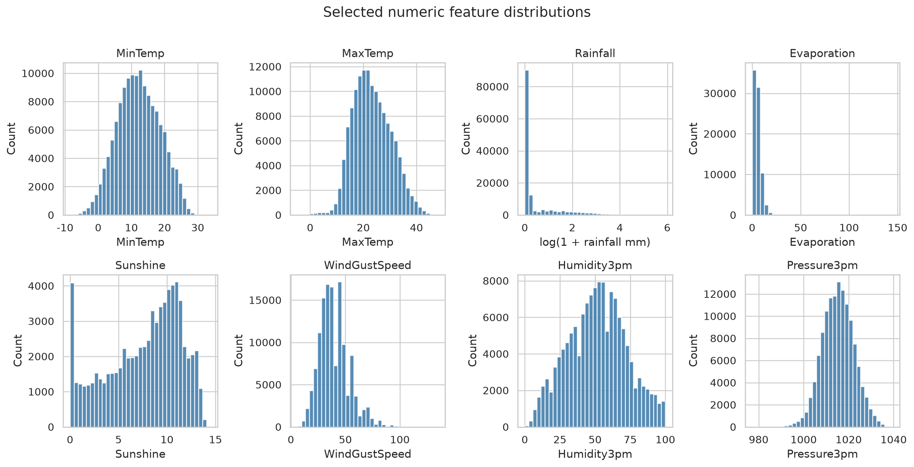

Fig. 9. Distributions of selected numeric predictors (rainfall on a log(1 + rainfall) scale).

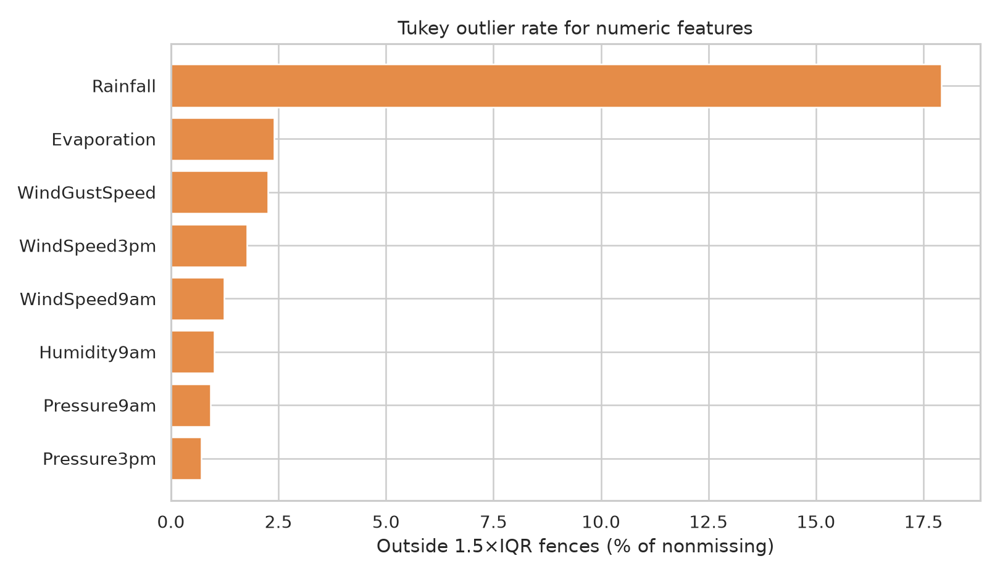

Fig. 10. Share of non-missing values outside the Tukey 1.5×IQR fences; values are flagged, not removed.

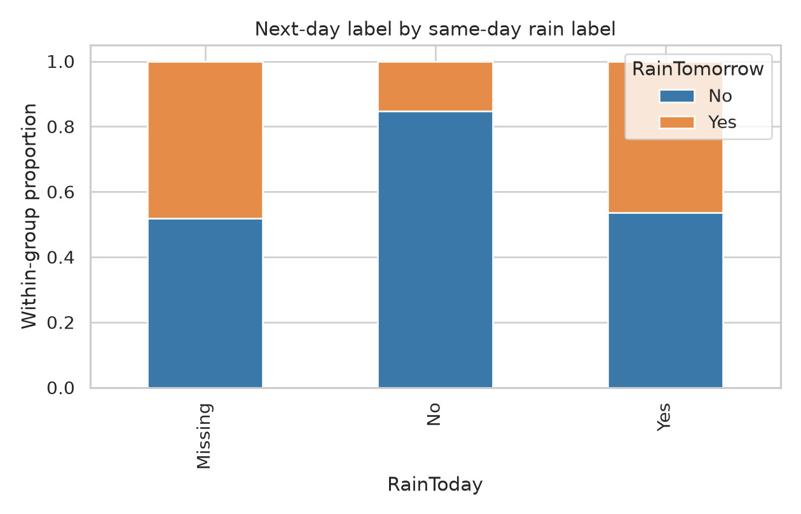

Fig. 11. Next-day label proportions by same-day rain label (the Missing category is descriptive).

## APPENDIX C. REPRODUCIBILITY AND CODE AVAILABILITY

**Code.** The source code, cleaned data log, outputs and this paper are in the project repository: https://github.com/YOUR-USERNAME/rainfall-ml-paper (replace with the final repository link before submission). The raw and cleaned CSV files are excluded from public hosting unless redistribution is authorised.

**Commands.** From the project root: python src/clean_data.py --input raw_data/weatherAUS.csv --output-dir cleaned_data; python src/eda.py --input cleaned_data/weatherAUS_clean.csv --output-dir outputs/eda; python src/train.py --data cleaned_data/weatherAUS_clean.csv --output-dir outputs/modeling --test-fraction 0.20 --cv-rows 8000 --knn-fit-rows 20000; python src/ablation.py --data cleaned_data/weatherAUS_clean.csv --output-dir outputs/ablation.

**Environment.** The main benchmark was run with Python 3.12.3, pandas 3.1.0 and scikit-learn 1.9.1 (seed 42). The ablation script was run in a separate environment with pandas 3.0.6, scikit-learn 1.9.1 and CatBoost 1.2.10; its reference variant reproduced the main CatBoost holdout metrics exactly to four decimals. The ablation results are saved in outputs/ablation/ablation_results.csv.

**Data.** The input is a course-supplied snapshot (weatherAUS.csv, SHA-256 573fd715…ed424014). Its exact upstream version and sharing terms were not independently verified; confirm them with the course instructor before public release.
